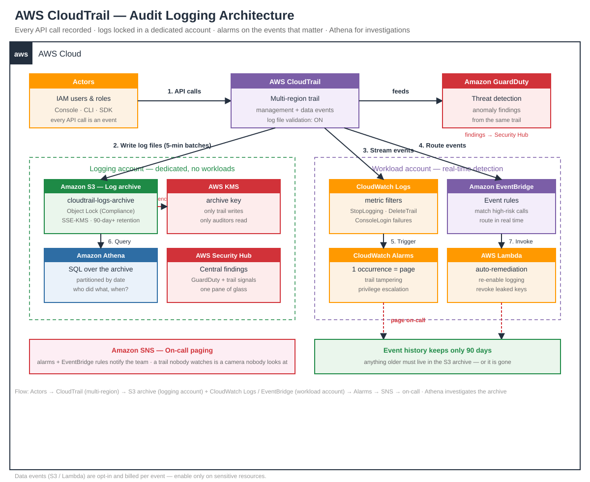

# AWS CloudTrail Audit Guide — Every API Call, On the Record


> **TL;DR** — CloudTrail is AWS's flight recorder: every API call in your account — who did it, from where, with what result — is written to an immutable log. Without it, a breach is a mystery; with it, it's a timeline. This guide shows how to run a multi-region trail the right way: one trail for all regions, logs locked in a dedicated S3 archive, CloudWatch alarms on the events that matter, and Athena queries that turn raw JSON into answers in seconds.

---

## 🗺️ Architecture



The diagram shows a production audit setup: a **multi-region trail** captures management and data events from every region into a dedicated **S3 log archive** (SSE-KMS, Object Lock, access logging). The same events stream to **CloudWatch Logs** for real-time metric filters and alarms, **EventBridge** routes high-risk events to **Lambda** and **SNS**, and **Athena** queries the archive for investigations. **GuardDuty** and **Security Hub** consume the same trail as a detection source.

---

## 🧭 What CloudTrail records — and what it doesn't

| | **Recorded** | **Not recorded** |
|---|---|---|
| **Management events** | IAM, EC2, S3, VPC, console and API activity | — |
| **Data events** | S3 object reads/writes, Lambda invokes (opt-in) | Contents of the objects themselves |
| **Insights events** | Unusual API call rates (opt-in) | The business meaning of a call |
| **Coverage** | All regions (multi-region trail), all accounts (organization trail) | On-prem systems, unless sent via CloudWatch |

**The 90-day rule:** the CloudTrail event history console only keeps 90 days. Anything older must live in your S3 archive — or it's gone.

---

## ⚖️ Management vs data events — choose deliberately

| | Management events | Data events |
|---|---|---|
| **Volume** | Low — control-plane calls | High — every object read/write |
| **Cost** | First trail free (one copy per region) | Charged per event — can get expensive fast |
| **Default** | On, always | Off — enable selectively |
| **Use when** | Always — this is your audit baseline | Forensics on a sensitive bucket, or Lambda invoke tracing |

**Rule of thumb:** log management events everywhere, data events only on the buckets and functions where you would actually investigate. A data-events trail on a busy bucket can cost more than the bucket itself.

---

## 🧯 The events you must alarm on

Some API calls are smoke; others are fire. Alarm on these — a single occurrence is worth waking someone up for:

- `StopLogging` / `DeleteTrail` / `UpdateTrail` — someone is trying to blind you
- `ConsoleLogin` with `errorMessage: Failed authentication` — brute-force on the console
- `CreateUser` / `PutUserPolicy` / `AttachUserPolicy` — privilege escalation in progress
- `AuthorizeSecurityGroupIngress` opening `0.0.0.0/0` — a door swung wide open
- `CreateAccessKey` / `DeleteTrail` from an unusual IP — credential theft in motion
- `PutBucketPolicy` on the log archive bucket — tampering with the evidence itself

> A trail that nobody watches is a security camera nobody looks at. The alarm is the point; the log is just the tape.

---

## 🔒 Locking the log archive — tamper-evidence

- **Separate account, separate bucket.** The log archive lives in a dedicated logging account, so a compromised workload account can't delete its own history.
- **S3 Object Lock (Compliance mode)** — log objects can't be deleted or overwritten, not even by the bucket owner, until retention expires.
- **SSE-KMS with a dedicated key** — the archive key lives in the logging account, with a key policy that allows only the trail to write and only auditors to read.
- **Bucket policy denies deletes** — explicitly deny `s3:DeleteObject` and `s3:PutBucketPolicy` for everyone except the logging account's break-glass role.
- **Access logging on the archive bucket itself** — who read the logs is itself logged.
- **Log file validation** — CloudTrail signs each log file with a digest; `validate-logs` proves no one edited a file in place.

---

## 🧑‍💻 Code — investigate like an incident responder

See [`audit.py`](audit.py) — a runnable demo that:

1. Queries CloudTrail event history for the riskiest API calls of the last 24 hours.
2. Runs an **Athena** query over the S3 archive to find who called `DeleteTrail` or `StopLogging`.
3. Validates log-file integrity with `validate-logs`.
4. Works **offline** with a built-in simulator when no AWS credentials are present.

```bash
python audit.py              # offline simulator demo
python audit.py --live       # real AWS (needs boto3 + credentials)
```

```python
# The core idea in 6 lines (see audit.py for the full demo)
events = trail.lookup_events(
    LookupAttributes=[{"AttributeKey": "EventName", "AttributeValue": "StopLogging"}],
    MaxResults=10,
)
for e in events["Events"]:
    print(e["EventTime"], e["Username"], e["CloudTrailEvent"])
```

---

## ✅ Production checklist

- [ ] Multi-region trail in **every** account (organization trail for multi-account)
- [ ] Log archive in a **dedicated logging account**, SSE-KMS + Object Lock
- [ ] Log file validation enabled; validate on a schedule
- [ ] CloudWatch Logs delivery + metric filters for the six alarm events above
- [ ] Data events enabled only on sensitive buckets/functions
- [ ] Athena table over the archive, partitioned by date — test a query before you need it
- [ ] Trail changes alert to a channel a human actually reads
- [ ] Break-glass access to the archive tested (can you actually read your own logs?)

---

## 🧠 Quiz teaser

Your CloudTrail trail was deleted at 03:12 — how would you prove it, and where would the evidence live? What does log file validation actually protect against? Test yourself in [`quiz.md`](quiz.md) — 5 questions, answers collapsed.

---

## 🔗 Keep learning

- [AWS CloudTrail User Guide](https://docs.aws.amazon.com/awscloudtrail/latest/userguide/cloudtrail-user-guide.html)
- [Logging CloudTrail events to CloudWatch Logs](https://docs.aws.amazon.com/awscloudtrail/latest/userguide/send-cloudtrail-events-to-cloudwatch-logs.html)
- [Validating CloudTrail log file integrity](https://docs.aws.amazon.com/awscloudtrail/latest/userguide/cloudtrail-log-file-validation-intro.html)
- [Querying CloudTrail logs with Athena](https://docs.aws.amazon.com/athena/latest/ug/cloudtrail-logs.html)

---

*Part of the daily cloud engineering series — one standalone guide per day. Previous: [aws-sqs-sns-messaging-guide](https://github.com/sepkascurty-cpu/aws-sqs-sns-messaging-guide).*
